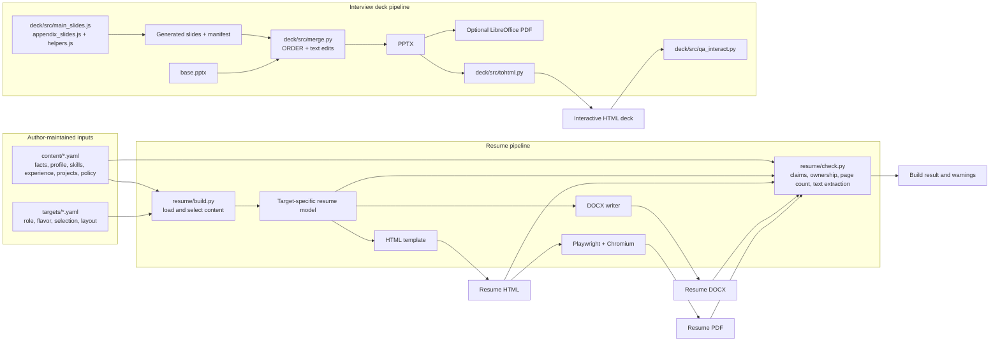
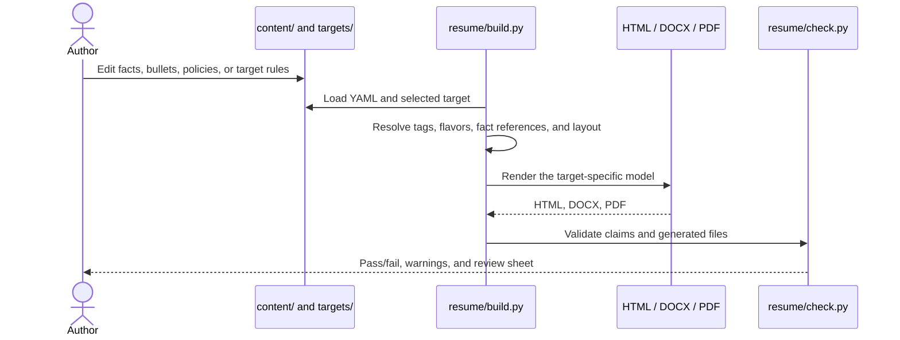

# Project Design

Resume Kit turns structured career information into role-specific resumes and an interview presentation. Its design centers on keeping career facts and claims in editable source files, then applying target-specific selection and rendering rules to produce reviewable documents.

## Design Intent

HTML has useful potential as a presentation format: it is easy to generate, distribute, and view. The longer-term idea is to use AI and reusable skills to help transform structured material into presentation-ready HTML without requiring users to hand-author markup or understand its implementation details. AI should assist with the content workflow, while generated changes remain reviewable and pass the project's existing validation rules.

This describes the direction, not a current runtime feature. Resume builds currently use deterministic Python scripts and YAML configuration. The interview deck is built from JavaScript slide sources and a base PowerPoint file; it does not yet consume the shared career-content YAML.

## System Overview

The pipelines are intentionally shown separately: resumes share the structured YAML source, while the deck currently has its own slide sources and PowerPoint base file.

## Resume Components

- `content/` contains the author-maintained career record. Facts are stored once in `facts.yaml`; bullets and projects carry tags or metadata used during selection.
- `targets/` describes each resume variant: headline, layout, content selection, and wording flavor. A target decides what to include, not the underlying truth of a claim.
- `resume/build.py` loads the content and target, resolves variants and fact references, then creates a target-specific model.
- `resume/templates/resume.html.j2` renders HTML. The DOCX writer creates Word output from the same model; Playwright and Chromium print the HTML to PDF.
- `content/policy.yaml` and `resume/check.py` enforce content and output constraints, including banned claims, known typos, ownership verbs, self-directed project labels, page limits, and PDF text extraction. Unverified facts are reported as warnings.
- Each build writes a `.review.md` sheet with the ownership metadata for selected bullets and the source of facts used in that resume.

### Resume Data Flow

## Deck Components

- `deck/src/main_slides.js` and `appendix_slides.js` define new and updated slides, using shared helpers from `helpers.js`.
- `deck/src/build_new.js` creates a generated PPTX and a slide manifest.
- `deck/src/merge.py` combines those slides with `deck/base.pptx`, orders slides using `ORDER`, applies configured text edits, and updates slide numbering.
- `deck/build.sh` orchestrates generation, merging, optional PDF export via LibreOffice, and conversion to HTML.
- `deck/src/tohtml.py` converts the final PPTX into a self-contained interactive HTML presentation. `deck/src/qa_interact.py` smoke-tests its navigation and interactions.

## Design Boundaries

- YAML is the editable source of truth for resume content; generated files under `out/` are build artifacts and should not be edited directly.
- Targets can change selection and wording but do not override the claim and ownership policies.
- Resume output formats are generated from the same target-specific model to keep their content aligned.
- The deck is a separate build path today. Bringing its overview slides into alignment with `content/` is a future integration, not an existing data flow.
- AI is a design direction, not a dependency of `make resume` or `make deck`. A future AI-assisted step should preserve explicit human review and the existing validation gates.
